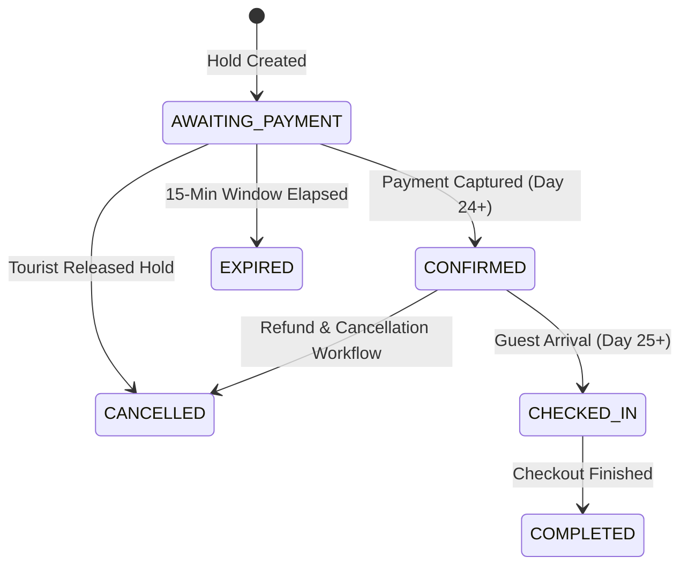
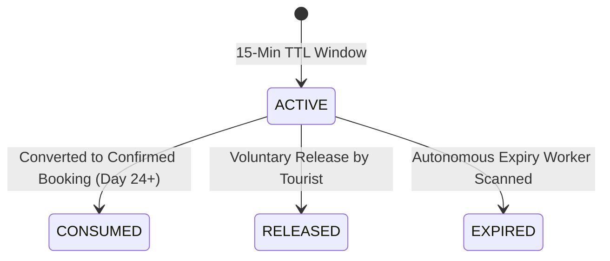

# Booking Engine Architecture & Concurrency Control

## 1. Executive Summary

The Kerala Tourism Booking Engine provides a high-concurrency, ACID-compliant reservation foundation for hotels, resorts, homestays, and villas across Kerala.

Designed for financial precision and zero double-booking under race conditions, the Day 23 subsystem manages:
1. Multi-night room availability validation.
2. Temporary inventory holds (15-minute reservation window).
3. Integer paise financial calculations ($1\text{ INR} = 100\text{ paise}$).
4. Idempotency protection with client-supplied `Idempotency-Key` headers.
5. Autonomous background inventory restoration for expired holds.

> [!IMPORTANT]
> **Strict Day 23 Scope Boundaries**:
> Payment processing, webhooks, refunds, merchant payouts, and completed stay workflows are deferred to Day 24+. Payment state is maintained independently of reservation hold status.

---

## 2. State Machine & Lifecycle

### 2.1 Booking Status Lifecycle


### 2.2 Inventory Hold Status Lifecycle


---

## 3. High-Concurrency & Double-Booking Prevention

### 3.1 Conditional Atomic Decrement
To prevent overbooking when multiple tourists attempt to hold the last available room simultaneously, inventory deduction is performed with atomic conditional updates on `RoomInventoryModel` across every individual stay night:

```typescript
for (const dateStr of stayDates) {
  const dateObj = parseCalendarDate(dateStr);
  const result = await RoomInventoryModel.updateOne(
    {
      propertyId,
      roomTypeId,
      date: dateObj,
      availableUnits: { $gte: numberOfRooms },
    },
    {
      $inc: { availableUnits: -numberOfRooms },
    },
    { session }
  );

  if (result.matchedCount === 0) {
    throw new ConflictError(
      `Insufficient room inventory available for date: ${dateStr}`,
      'INSUFFICIENT_INVENTORY'
    );
  }
}
```

### 3.2 ACID Transaction Guarantees
All operations (conditional inventory decrements, booking record creation, and hold generation) execute within a single MongoDB multi-document transaction (`withTransaction`). If any date in the stay has insufficient units, the transaction immediately aborts, rolling back all previously decremented dates with zero data corruption.

---

## 4. Autonomous Expiry & TTL Isolation

### 4.1 The Two-Tiered Expiry Architecture
MongoDB's native TTL mechanism only deletes documents and **cannot execute application business logic** (such as incrementing inventory in another collection).

Therefore, the platform strictly decouples storage cleanup from business inventory restoration:
1. **Application-Driven Inventory Restoration**:
   - `BookingHoldExpiryService.processExpiredHoldsBatch()` scans for active holds where `expiresAt <= now`.
   - Within an atomic transaction, the hold status transitions `ACTIVE -> EXPIRED`, and `availableUnits` is incremented back across all stay dates.
   - The associated booking status transitions `AWAITING_PAYMENT -> EXPIRED`.
2. **Eventual Storage Cleanup**:
   - A 7-day MongoDB TTL index on `expiresAt` (`expireAfterSeconds: 604800`) safely purges old `inventoryHolds` documents from disk without impacting inventory balance.

---

## 5. Financial Precision & Idempotency

### 5.1 Integer Paise Calculations
Floating-point arithmetic is prohibited for currency calculations.
- `basePricePaise`: Room base price in integer paise ($100.00\text{ INR} = 10,000\text{ paise}$).
- `subtotalPaise = basePricePaise * numberOfRooms * numberOfNights`.
- `totalPaise = subtotalPaise + taxesPaise`.
- INR representations (`subtotalInr`, `totalInr`) are provided as derived values (`Math.round(paise / 100)`) for presentation.

### 5.2 Scoped Idempotency
- Clients provide an `Idempotency-Key` header with `POST /api/v1/tourist/bookings/holds`.
- Keys are scoped per authenticated tourist (`{ touristAccountId: 1, key: 1 }`).
- Requests with matching payload hashes return the cached response immediately.
- Requests with the same key but differing payloads are rejected with `409 Conflict`.
- Idempotency records expire automatically after 24 hours via MongoDB TTL.
