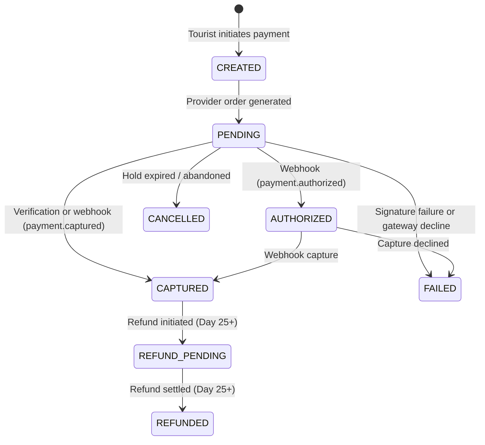

# Payment Engine Architecture & Lifecycle Specification (Day 24)

## 1. Architectural Overview

The Kerala Tourism platform payment subsystem provides secure, PCI-DSS compliant, provider-agnostic financial transaction processing for accommodation bookings. It bridges temporary inventory holds created in Day 23 with final reservation confirmation.

```
┌─────────────────────────────────────────────────────────────────────────────┐
│                             CLIENT CHECKOUT FLOW                            │
│                                                                             │
│  [ Tourist App / Web ]                                                      │
│        │                                                                    │
│        │ 1. POST /api/v1/tourist/bookings/:bookingId/payments               │
│        ▼                                                                    │
│  [ PaymentsService ] ──► Validates Hold (ACTIVE, Unexpired)                 │
│        │             ──► Extracts Total (Server Price Snapshot in Paise)    │
│        │             ──► Creates Internal Payment (status: CREATED)         │
│        │             ──► RazorpayPaymentProvider.createOrder()              │
│        │             ──► Updates Payment (status: PENDING, providerOrderId) │
│        ▼                                                                    │
│  [ Tourist Receives Public Checkout Payload ]                               │
│        │                                                                    │
│        │ 2. Tourist completes payment in Razorpay Checkout modal            │
│        ▼                                                                    │
│  ┌─────────────────────────────────┬─────────────────────────────────────┐  │
│  │       CLIENT CALLBACK           │           WEBHOOK EVENT             │  │
│  │ (POST /tourist/payments/verify) │    (POST /webhooks/razorpay)        │  │
│  └────────────────┬────────────────┴──────────────────┬──────────────────┘  │
│                   │                                   │                     │
│                   ▼                                   ▼                     │
│  ┌───────────────────────────────────────────────────────────────────────┐  │
│  │             MONGODB ACID MULTI-DOCUMENT TRANSACTION                   │  │
│  │                                                                       │  │
│  │  1. Transition Payment: PENDING ──► CAPTURED                          │  │
│  │  2. Inspect Hold:                                                     │  │
│  │     • If Hold ACTIVE & Unexpired:                                     │  │
│  │         Hold ──► CONSUMED                                             │  │
│  │         Booking: AWAITING_PAYMENT ──► CONFIRMED                       │  │
│  │     • If Hold EXPIRED / RELEASED (Critical Late Payment):             │  │
│  │         Hold stays EXPIRED                                            │  │
│  │         Booking stays EXPIRED/CANCELLED (NO Overbooking)              │  │
│  │         Payment: CAPTURED with reconciliationStatus: FLAGGED          │  │
│  └───────────────────────────────────────────────────────────────────────┘  │
└─────────────────────────────────────────────────────────────────────────────┘
```

---

## 2. State Machines & Monotonicity Rules

### 2.1 Payment Lifecycle (`payments`)



### 2.2 Transition Hierarchy & Monotonicity Guarantees

To eliminate race conditions between frontend callback verification and asynchronous webhook arrivals:
1. **Terminal Capture State**: Once a payment transitions to `CAPTURED`, it **cannot** be downgraded to `PENDING`, `AUTHORIZED`, or `FAILED`.
2. **Idempotent Short-Circuit**: If a verification request or webhook arrives for an already `CAPTURED` payment, the transaction short-circuits immediately and returns the current confirmed record without duplicate inventory decrements or redundant state updates.
3. **Out-of-Order Webhook Protection**: A delayed `payment.failed` or `payment.authorized` webhook arriving after a successful checkout verification will be acknowledged with HTTP 200 and ignored.

---

## 3. Critical Late-Payment Reconciliation

A provider may capture payment after the 15-minute temporary inventory hold has expired (e.g. user took 18 minutes to approve netbanking transaction or bank webhook arrived late).

**Strict Anti-Overbooking Invariants**:
- The booking is **NEVER** confirmed without active reserved inventory.
- The hold is **NEVER** consumed if it has already expired or was released.
- The system **NEVER** silently restores or re-decrements inventory (as other tourists may have reserved the room in the meantime).
- The payment record is updated to:
  ```json
  {
    "status": "CAPTURED",
    "reconciliationStatus": "FLAGGED_FOR_MANUAL_REVIEW",
    "failureCode": "LATE_PAYMENT_HOLD_EXPIRED",
    "failureDescription": "Payment captured after inventory hold expired or was released"
  }
  ```
- An audit log event `PAYMENT_LATE_RECONCILIATION` is persisted.
- The booking remains in `EXPIRED` or `CANCELLED`.
- This ensures absolute consistency while queuing the transaction for automated refund or merchant manual reallocation.
