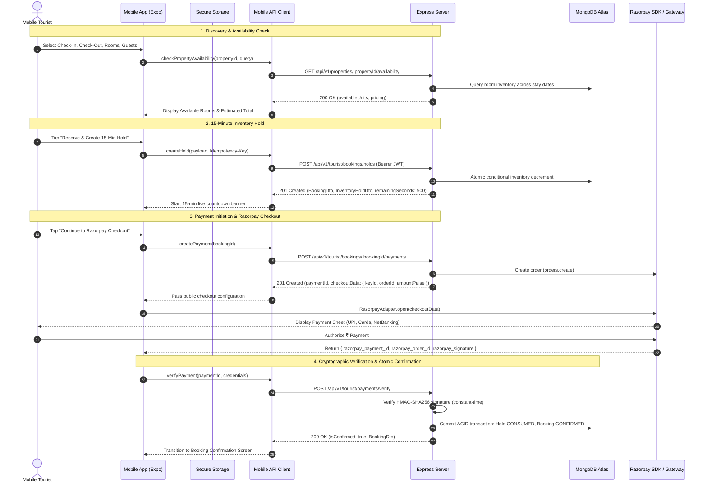

# Mobile Booking & Payment Integration Architecture

## 1. Executive Summary

The **Kerala Tourism Mobile Booking & Payment Integration** (Day 25) connects the React Native / Expo mobile application (`apps/mobile`) to the production backend APIs established in Day 21 (Properties), Day 22 (Rooms & Inventory), Day 23 (Booking Engine & 15-Minute Holds), and Day 24 (Payment Integration & Webhooks).

The integration delivers an end-to-end booking journey designed around five architectural pillars:
1. **Zero Client Price Trust**: All calculations (rates, stay nights, multi-room multipliers, GST, and total amounts) are performed authoritatively by the backend in integer paise ($1\text{ INR} = 100\text{ paise}$).
2. **Hardware-Backed Secure Storage & Volatile Tokens**: Refresh tokens and account identity are stored exclusively in hardware-backed secure storage via `SecureStorageService`. Access tokens are held exclusively in volatile application memory and refreshed via a single-flight mutex.
3. **Resilient Razorpay Mobile Checkout Adapter**: Unified adapter supporting native Razorpay checkout in prebuild/EAS custom development builds with a safe sandbox fallback for Expo Go and headless CI test execution.
4. **Authoritative 15-Minute Hold Lifecycle**: Visual countdown timer ticks down from the server's `expiresAt` timestamp, halting checkout if the window expires and preventing race conditions or double booking.
5. **Post-Checkout Recovery**: In the event of app crashes or network disconnects, the mobile application recovers authoritative state directly from backend endpoints rather than attempting duplicate transactions.

---

## 2. End-to-End System Flow



---

## 3. Core Mobile Components & File Structure

```
apps/mobile/src/
├── components/
│   ├── GuestForm.tsx               # Primary guest name, email, phone form with validation
│   ├── Header.tsx                  # Standard top bar with back navigation & screen title
│   ├── HoldCountdownBanner.tsx     # Visual 15-min countdown timer (Green -> Amber -> Red)
│   ├── PriceBreakdownCard.tsx      # Authoritative integer paise price formatter (₹)
│   ├── StateViews.tsx              # Loading skeleton, ErrorView, and EmptyView states
│   └── StatusBadge.tsx             # Booking & payment lifecycle status pills
├── context/
│   ├── AuthContext.tsx             # Tourist authentication session provider
│   └── BookingContext.tsx          # Active hold state, countdown timer, idempotency key
├── navigation/
│   ├── AppNavigator.tsx            # Screen dispatcher & persistent bottom dock
│   ├── NavigationContext.tsx       # Zero-native-dependency typed navigation stack
│   └── types.ts                    # RootScreenName & ScreenParamsMap type contracts
├── screens/
│   ├── BookingConfirmationScreen.tsx# Celebratory confirmed reservation display
│   ├── BookingDetailsScreen.tsx    # Comprehensive booking details & QR reference
│   ├── BookingHistoryScreen.tsx    # Upcoming vs. Past bookings segmented tabs
│   ├── BookingReviewScreen.tsx     # 15-minute hold review, guest form & hold release
│   ├── DateGuestSelectionScreen.tsx# Stay calendar & live availability check
│   ├── LoginScreen.tsx             # Tourist authentication screen with return navigation
│   ├── PaymentCheckoutScreen.tsx   # Razorpay checkout launcher & recovery handling
│   └── PropertyDetailsScreen.tsx   # Property images, facilities, and room types list
├── services/
│   ├── api.ts                      # Typed API client with 401 single-flight retry
│   ├── auth.service.ts             # Volatile memory access tokens & SecureStore refresh tokens
│   ├── booking.service.ts          # Availability, holds, releases, and booking queries
│   ├── payment.service.ts          # Payment initiation, checkout launch, verification, recovery
│   ├── razorpay.adapter.ts         # Unified Razorpay adapter (Native / Sandbox / Test Mock)
│   └── secure-storage.ts           # Hardware-backed SecureStore adapter with test fallback
├── tests/
│   ├── mobile-auth.test.ts         # Secure store, single-flight mutex & logout tests
│   ├── mobile-booking.test.ts      # Availability, hold lifecycle & 401 retry tests
│   ├── mobile-payment.test.ts      # Initiation, cancellation, verification & recovery tests
│   └── mobile-ui.test.ts           # Currency formatting, timer formatting & status tests
└── utils/
    └── formatters.ts               # formatPaiseToInr and formatSecondsToTimer utilities
```

---

## 4. Security & Authentication Architecture

### 4.1 Token Storage Policies
- **Access Tokens**: Maintained strictly in volatile RAM memory (`authService.accessToken`). They are never persisted to disk, `AsyncStorage`, or log files.
- **Refresh Tokens**: Persisted exclusively in hardware-backed secure storage via `SecureStorageService` (`expo-secure-store` Keystore on Android, Keychain on iOS).
- **Credentials Cleansing**: On logout or session revocation, all memory variables and secure storage items are purged immediately.

### 4.2 Single-Flight Refresh Mutex
When an access token expires while multiple network requests are made concurrently, the API client coordinates a single-flight mutex:
```typescript
private refreshPromise: Promise<string | null> | null = null;

public async refreshToken(): Promise<string | null> {
  if (this.refreshPromise) {
    return this.refreshPromise;
  }
  this.refreshPromise = this.performTokenRefresh();
  try {
    return await this.refreshPromise;
  } finally {
    this.refreshPromise = null;
  }
}
```
All pending requests wait for the same promise to resolve before retrying transparently with the new rotated access token.

---

## 5. Razorpay Mobile Integration & Environment Compatibility

### 5.1 Unified Checkout Adapter
The mobile application uses `RazorpayMobileAdapter`:
```typescript
export class RazorpayMobileAdapter {
  async open(options: RazorpayCheckoutOptions): Promise<RazorpaySuccessResponse>
}
```

### 5.2 Environment Compatibility Matrix
| Environment | Execution Mechanism | Behavior |
|---|---|---|
| **Expo Go** | Sandbox Simulation Fallback | Simulates successful test transaction without crashing on missing native binaries. |
| **Custom Dev Build (`run:android` / `run:ios`)** | `react-native-razorpay` Native Module | Launches official Razorpay native Android Activity / iOS ViewController. |
| **EAS Production Build** | `react-native-razorpay` Native Module | Full production-ready checkout with UPI intent, Cards, NetBanking. |
| **Headless CI / Automated Tests** | `MockPaymentHandler` Hook | Deterministic simulated response with zero network dependencies. |

### 5.3 Zero Secret Leakage Invariant
The mobile application only receives and handles public checkout parameters:
- `keyId`: Public gateway identifier (e.g. `rzp_test_...`).
- `orderId`: Provider order identifier (e.g. `order_...`).
- `amountPaise`: Integer paise calculated by backend.
- `currency`: `'INR'`.
- `prefill`: `{ name, email, contact }`.

**Razorpay API Key Secret and Webhook Secret are never included in the mobile client bundle.**

---

## 6. Error Recovery & Disconnect Resilience

### 6.1 User Checkout Cancellation
When a user dismisses the payment modal before completion:
- The adapter raises a `RazorpayCheckoutError` with code `PAYMENT_CANCELLED`.
- The application catches this cleanly, keeps the 15-minute inventory hold active, displays a non-destructive warning, and allows the user to re-open checkout.

### 6.2 App Interruption Post-Payment
If the mobile application crashes or loses network connectivity immediately after the user authorizes payment:
- The backend's webhook engine independently captures the payment and confirms the reservation upon receiving `payment.captured`.
- Upon re-opening the application, `paymentService.recoverPaymentStatus(bookingId, paymentId)` checks the authoritative database status.
- If already confirmed, the booking is rendered immediately as `CONFIRMED` without initiating duplicate transactions.

### 6.3 Critical Late Payment (Hold Expired)
If payment is authorized after the 15-minute hold expires:
- The backend ACID transaction prevents overbooking by keeping the reservation in `EXPIRED` status and setting payment `reconciliationStatus = 'FLAGGED_FOR_MANUAL_REVIEW'`.
- The mobile application detects `isConfirmed: false` and prompts the user that their booking is under manual operator review, preventing double decrements of inventory.

---

## 7. Environment Configuration

Create or update `.env` in `apps/mobile`:
```env
EXPO_PUBLIC_API_URL=http://10.0.2.2:5000   # For Android Emulator loopback
# EXPO_PUBLIC_API_URL=http://localhost:5000 # For iOS Simulator or Web
```

---

## 8. Verification Commands

```bash
# Run Mobile Unit & Integration Test Suite
npm run test --workspace=@kerala-tourism/mobile

# Run Mobile TypeScript Typecheck
npm run typecheck --workspace=@kerala-tourism/mobile

# Run Mobile ESLint Check
npm run lint --workspace=@kerala-tourism/mobile

# Run Monorepo-Wide Typecheck (all 9 workspaces)
npm run typecheck
```
