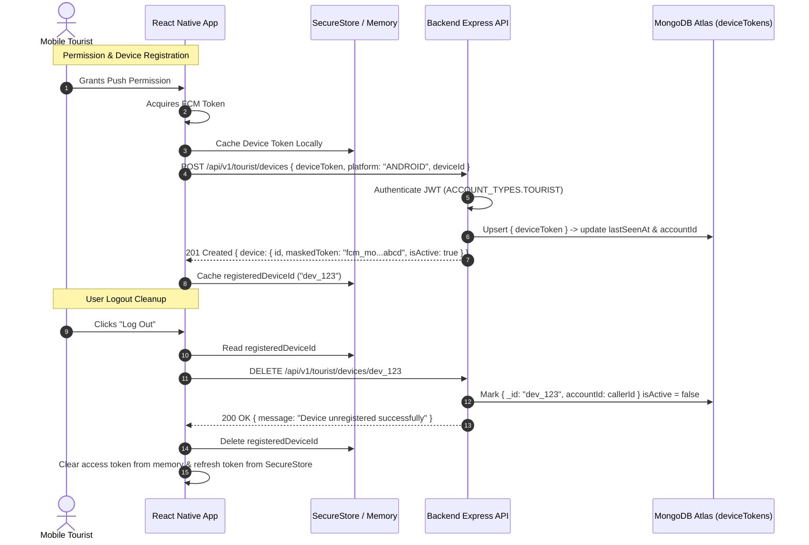
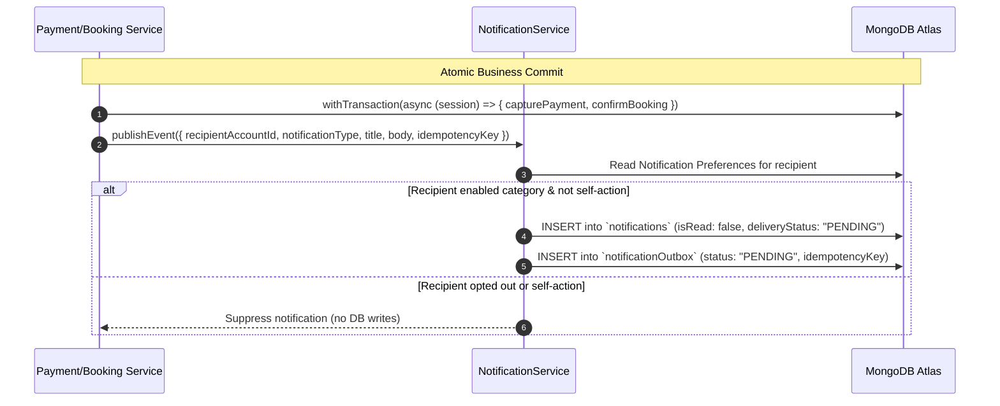
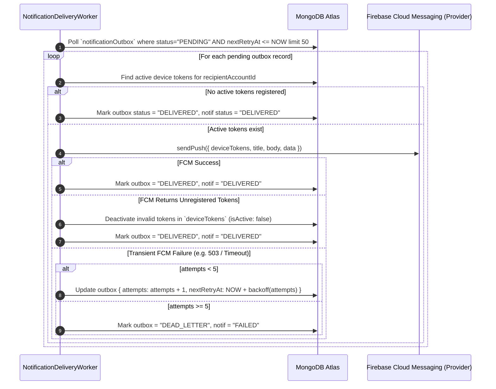

# Push Notifications, FCM & Mobile Notification Management Architecture (Day 26)

## 1. Executive Summary

The Kerala Tourism platform push notification system delivers reliable, low-latency, and privacy-preserving notifications to tourists across mobile devices. It connects core business events—booking confirmations, payment captures, payment failures, and social interactions—with native mobile push alerts and an authoritative in-app notification tray.

### Core Architectural Principles
1. **Decoupled Outbox Pattern**: Push delivery calls to external services (Firebase Cloud Messaging) are strictly decoupled from MongoDB transactions. Core business logic (payment capture, booking creation) commits locally and schedules an entry into `notificationOutbox` without waiting on external networks.
2. **At-Least-Once Delivery with Idempotency**: Each event generates a deterministic `idempotencyKey` guaranteeing deduplication across gateway retries and background polling runs.
3. **Bounded Exponential Backoff**: Transient provider errors trigger automatic exponential retries with bounded jitter ($1\text{s} \to 2\text{s} \to 4\text{s} \dots \le 60\text{s}$). Items exceeding 5 attempts transition safely to `DEAD_LETTER` status.
4. **Self-Healing Token Invalidation**: When FCM reports `messaging/registration-token-not-registered` or `messaging/invalid-registration-token`, the delivery worker immediately marks the corresponding token inactive, preventing wasteful transmissions.
5. **Zero-Trust Security & BOLA Protection**:
   - Device tokens are stored hashed/raw internally but masked on read endpoints (`fcm_...1234`).
   - Device and notification deletion/mutation endpoints enforce strict ownership checks and conceal unauthorized access attempts with uniform HTTP 404 responses.
   - Firebase Admin SDK credentials and private keys exist exclusively in backend environment variables and are never transmitted to mobile or web clients.

---

## 2. End-to-End Sequence Diagrams

### 2.1 Device Registration & Logout Lifecycle

### 2.2 Event Trigger & Outbox Dispatch

### 2.3 Delivery Worker & Self-Healing Token Invalidation

---

## 3. Database Collections & Schemas

### Collection 6: `deviceTokens`
Stores mobile device push tokens mapped to authenticated accounts.
- **`accountId`**: `ObjectId` ref `Account`, required.
- **`deviceToken`**: `String`, unique, required.
- **`platform`**: `String` enum (`ANDROID`, `IOS`), required.
- **`provider`**: `String` enum (`FCM`), default `FCM`.
- **`deviceId`**: `String`, client hardware or installation ID.
- **`isActive`**: `Boolean`, default `true`.
- **`lastSeenAt`**: `Date`, default `Date.now`.
- **`invalidatedAt`**: `Date`, nullable.
- **`invalidReason`**: `String`, nullable (`USER_UNREGISTERED`, `FCM_UNREGISTERED`).
- **Indexes**:
  - `{ deviceToken: 1 }` (unique)
  - `{ accountId: 1, isActive: 1 }`
  - `{ lastSeenAt: 1 }` (90-day cleanup TTL)

### Collection 47: `notifications`
Authoritative in-app notification tray records.
- **`recipientAccountId`**: `ObjectId` ref `Account`, required.
- **`notificationType`**: `String` enum (`NOTIFICATION_TYPES`), required.
- **`title`**: `String` (max 150 chars), required.
- **`body`**: `String` (max 500 chars), required.
- **`dataPayload`**: `Map<String, String>` (safe deep-link parameters).
- **`relatedResourceType`**: `String` enum (`BOOKING`, `PAYMENT`, `POST`, `ACCOUNT`).
- **`relatedResourceId`**: `String`, nullable.
- **`isRead`**: `Boolean`, default `false`.
- **`readAt`**: `Date`, nullable.
- **`deliveryStatus`**: `String` enum (`PENDING`, `DELIVERED`, `FAILED`).
- **Indexes**:
  - `{ recipientAccountId: 1, createdAt: -1, _id: -1 }`
  - `{ recipientAccountId: 1, isRead: 1, createdAt: -1 }`
  - `{ relatedResourceType: 1, relatedResourceId: 1 }` (sparse)

### Collection 48: `notificationOutbox`
Durable delivery queue for decoupled push notification dispatch.
- **`notificationId`**: `ObjectId` ref `Notification`, required.
- **`recipientAccountId`**: `ObjectId` ref `Account`, required.
- **`idempotencyKey`**: `String`, unique, required.
- **`eventType`**: `String`, required.
- **`payload`**: `{ title: string, body: string, data?: Record<string, string> }`.
- **`status`**: `String` enum (`PENDING`, `PROCESSING`, `DELIVERED`, `FAILED`, `DEAD_LETTER`).
- **`attempts`**: `Number`, default 0.
- **`maxAttempts`**: `Number`, default 5.
- **`nextRetryAt`**: `Date`, default `Date.now`.
- **`lastError`**: `String`, optional.
- **`processedAt`**: `Date`, optional.
- **Indexes**:
  - `{ idempotencyKey: 1 }` (unique)
  - `{ status: 1, nextRetryAt: 1 }`
  - `{ createdAt: 1 }` (30-day purge TTL)

### Collection 49: `notificationPreferences`
Per-tourist category notification controls.
- **`accountId`**: `ObjectId` ref `Account`, unique, required.
- **`bookingUpdates`**: `Boolean`, default `true`.
- **`paymentUpdates`**: `Boolean`, default `true`.
- **`socialUpdates`**: `Boolean`, default `true`.
- **Index**: `{ accountId: 1 }` (unique)

---

## 4. REST API Specification

All endpoints require `Authorization: Bearer <JWT>` with active `TOURIST` role.

| Method | Path | Description | BOLA Protection |
| :--- | :--- | :--- | :--- |
| `POST` | `/api/v1/tourist/devices` | Register or refresh FCM token | Masks token on response |
| `GET` | `/api/v1/tourist/devices` | List authenticated user's active devices | Scoped to caller `accountId` |
| `DELETE` | `/api/v1/tourist/devices/:deviceId` | Deactivate registered device | 404 concealment on foreign device |
| `GET` | `/api/v1/tourist/notifications` | Paginated in-app notification tray | Scoped to caller `accountId` |
| `GET` | `/api/v1/tourist/notifications/unread-count` | Retrieve badge unread counter | Scoped to caller `accountId` |
| `PATCH` | `/api/v1/tourist/notifications/:id/read` | Mark individual notification as read | 404 concealment on foreign notification |
| `PATCH` | `/api/v1/tourist/notifications/read-all` | Bulk mark all caller notifications read | Scoped to caller `accountId` |
| `DELETE` | `/api/v1/tourist/notifications/:id` | Delete notification from tray | 404 concealment on foreign notification |
| `GET` | `/api/v1/tourist/notifications/preferences` | Retrieve notification toggles | Auto-creates default if absent |
| `PATCH` | `/api/v1/tourist/notifications/preferences` | Update category opt-out preferences | Strict Zod validation |

---

## 5. Mobile Application Integration (`apps/mobile`)

### Navigation & Deep-Linking Resolution
- Push notifications deliver metadata including `route` and resource identifiers (`bookingId`).
- When a user taps a notification or deep link, `mobileNotificationService.resolveDeepLinkTarget()` authoritatively re-verifies the resource against the backend API before navigating.
- If a booking was deleted, cancelled, or is inaccessible, navigation falls back safely to `BookingHistory` or `NotificationCenter`, preventing black screens or undefined crashes.

### Custom Dev Builds vs. Expo Go Simulation
- **Development & Test Simulation**: When running in Expo Go or headless automated test environments, `MobileNotificationService` uses deterministic simulated push tokens (`fcm_mobile_mock_<os>_<timestamp>_<random>`), allowing full end-to-end testing of device registration, tray synchronization, preferences, and deep links without requiring Google Play Services.
- **Native Production & Preview**: Uses Expo's custom dev client build (`npx expo run:android` / `npx expo run:ios`) with Google Services configuration (`google-services.json` and `GoogleService-Info.plist`).
